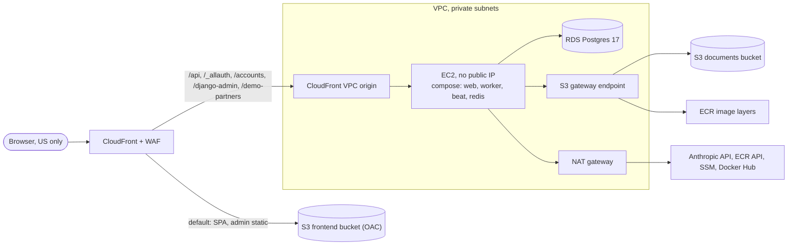

# Architecture

How ClearPath Compliance Review is built and deployed. For what it does, see [README.md](README.md). For why each
choice was made and what was rejected, see [docs/decisions.md](docs/decisions.md); this document links to it rather
than repeating it.

## Contents

- [Stack and why](#stack-and-why)
- [Domain model and invariants](#domain-model-and-invariants)
- [Checks pipeline](#checks-pipeline)
- [AWS deployment](#aws-deployment)
- [CI and deploy](#ci-and-deploy)
- [Security posture](#security-posture)
- [Testing](#testing)

## Stack and why

| Layer | Choice | Why |
|---|---|---|
| API | Django 6 + django-ninja ([`pyproject.toml`](backend/pyproject.toml)) | Typed schemas produce the OpenAPI spec; Django brings the ORM, migrations, admin, and django-allauth (headless mode, MFA). |
| Client contract | Orval-generated React Query hooks, zod schemas and MSW handlers from that spec ([`orval.config.ts`](frontend/orval.config.ts)) | One schema drives the client, validation and test mocks. The [`api-contract`](.github/workflows/api-contract.yaml) job regenerates both and fails on any drift from what's committed. |
| Frontend | React 19, Vite, TypeScript, TanStack Router, Query, Form, Table and Charts ([`package.json`](frontend/package.json)) | Headless and typed. Router keeps filters in validated URL search params, so every view is a link. **Rejected: MUI Data Grid**: multi-sort and multi-filter are Pro-only, and it brings a second styling system (Emotion) ([decisions](docs/decisions.md#stack)). |
| UI system | Tailwind v4 with tokens in one `@theme` file (default palette reset), a custom daisyUI theme, React Aria Components, Phosphor icons | React Aria gives correct focus and ARIA for menus, comboboxes, popovers and dialogs. Icons go through one registry, [`ui/icons.ts`](frontend/src/ui/icons.ts); ESLint bans importing Phosphor anywhere else, and [`icons.test.ts`](frontend/src/ui/icons.test.ts) fails if two meanings share a glyph ([spec §5.2a](docs/spec.md#52a-icons-one-meaning-per-glyph)). |
| Database | Postgres 17 | Transactions spanning decision, status and event; an append-only trigger on events; `EXCLUDE USING gist` so only one offer-terms version is in effect per product; trigram and full-text indexes for search; advisory locks for assignment; JSONB payloads. **Rejected: NoSQL** (loses joins, multi-row transactions, constraints). |
| Jobs | Celery + Redis | Outbox dispatch, AI checks, terms fan-out, drift checks, import/export jobs, and beat schedules (sweeps, reconcilers). Redis is disposable: the outbox lives in Postgres. |
| Assistant | LangChain v1 `create_agent` + `HumanInTheLoopMiddleware` + the LangGraph Postgres checkpointer; frontend on `@langchain/react` `useStream` | Runs are request-scoped SSE (a disconnect cancels the run). `useStream` talks to them through a custom adapter rather than the Agent Server protocol, which would need server-held runs and a replay buffer across uvicorn workers ([ledger ruling](docs/plan/ledger.md#rulings), [assistant report](docs/plan/reports/assistant.md)). **Rejected: Claude Agent SDK**: built for filesystem-and-shell agents, more than about 7 custom tools need ([decisions](docs/decisions.md#assistant-langchain-with-human-approval-before-sending)). |
| Tooling | uv, ruff (`select = ["ALL"]`), Pyrefly with django-stubs, pytest on real Postgres, Vitest (jsdom and real Chromium), Playwright, ESLint + Prettier + `tsc`, semgrep | Selectors return typed dataclasses to cover Pyrefly's loose typing of `annotate`/`values`. Tests run against the same `pgvector/pgvector:pg17` image as dev, because the schema depends on Postgres features. |

## Domain model and invariants

Entities, the status machine and the automation table are in [docs/product-spec.md](docs/product-spec.md). The
backend is one Django app per domain (`accounts`, `partners`, `terms`, `reviews`, `checks`, `audit`,
`notifications`, `imports`, `exports`, `metrics`, `assistant`, `drift`), each split into `models`, `services` (the
only writers), `selectors` (typed reads), `api` (thin), `schemas` and `tasks`.

```
draft → submitted → in_review → changes_requested → (new version) → submitted …
                              ↘ approved | rejected
approved → needs_rereview   (terms changed, approval expiring, drift found; only if live)
approved → expired          (not live)
needs_rereview → fast-track approve | pull (→ withdrawn) | reaffirm | in_review
```

**Service, event, outbox.** Every state change is one service function that checks the transition, updates the
rows, and records an `Event` in the same transaction. Events are insert-only (a trigger refuses updates and
deletes) and double as the transactional outbox: a dispatcher on a 2-second beat reads events by `(txid, id)` below
the snapshot horizon, so an event whose transaction commits late isn't skipped (an id-only cursor fails the
concurrency test). Handlers are keyed by name and event id, so at-least-once delivery applies each side effect once
([`audit/outbox.py`](backend/audit/outbox.py)). **Rejected: event sourcing**: projections, replay and event-schema
versioning that nothing here needs ([decisions](docs/decisions.md#data)).

**Invariants in the database**, as the last line of defense ([foundation report](docs/plan/reports/foundation.md)):
- insert-only triggers on events, versions, decisions, decision terms and evidence, and attachments;
- offer terms immutable except closing an open range, and no two versions of one product in effect at once;
- composite foreign keys so a decision, placement or current version always belongs to its own item;
- CHECKs: `needs_rereview` carries a reopen reason, decisions carry a reason and approvals an expiry, triaged
  findings record who and why, AI findings are warnings.

**Decision records.** A `Decision` references one exact version, the offer-terms versions it quotes, the rule-set
date, evidence by attachment and SHA-256, the approver, and the lane (standard, fast-track, reaffirm). Approve and
Approve with edits need every finding triaged; Approve with edits makes the reviewer author v+1 and approve that.

**Assignment** runs inside the submit transaction under `pg_advisory_xact_lock`, so load is computed after the lock
and two concurrent submits can't both pick a stale minimum
([`reviews/assignment.py`](backend/reviews/assignment.py); rejected alternatives `SKIP LOCKED` and row locks in
[decisions](docs/decisions.md#reviewer-assignment-automatic-with-claiming-still-allowed)).

**Error handling** ([spec §6.1](docs/spec.md#61-error-handling-handle-where-you-can-decide)). Services raise typed
domain errors (`InvalidTransition`, `OpenFindingsBlockDecision`, `NotPermitted`, `TermsRangeOverlap`, …,
[`core/errors.py`](backend/core/errors.py)), mapped to an HTTP status and stable error code once, in the `NinjaAPI`
exception handlers; endpoints contain no try/except. Expected outcomes are values: a bad AI span is dropped and
counted, an import row problem is a preview item. External calls retry at the integration boundary, and a final
failure becomes visible state (`llm_check_status = failed` with a Retry action), never a silent gap. The frontend has
one `ApiError` type, field-level 422s mapped onto form fields, and route error boundaries.

## Checks pipeline

Three sources, and every finding says which one it came from: code, AI, or human.

### 1. Code rules

[`checks/engine/`](backend/checks/engine/) is pure Python with no Django import: one shared analysis pass extracts
every rate, fee, amount, term and representative example, then each rule family checks it. 42 code rules and 4 human
checklist items, each with a citation and `effective_from` date
([rules-engine report](docs/plan/reports/rules-engine.md) has the full table). `RULESET_VERSION` moves when the law
does; `ENGINE_VERSION` moves when the code does, so a regex fix invalidates cached results. A 5 KB ad checks in
about 3 ms (asserted under 100 ms), which is what makes checks-as-you-type at intake possible. Rate and fee claims
are extracted as `TermsRef`s linked to the offer-terms version they quote.

### 2. AI pre-review

1. On submit, resubmit or a new round, the outbox handler `checks.llm_prereview` creates a pending run and enqueues
   `checks.run_llm_prereview` after commit ([`checks/handlers.py`](backend/checks/handlers.py),
   [`checks/prereview.py`](backend/checks/prereview.py)).
2. The task claims the run under the item row lock (duplicate deliveries are no-ops), then calls the model with
   **no transaction open**, because an open transaction would hold back the outbox's snapshot horizon.
3. The model must call one tool, `report_findings`. The system block (instructions plus all 7 rule definitions) is
   identical for every item and cached; the item message carries facts, applicable rules, offer terms, the code
   findings, and then the copy ([`checks/llm/prompt.py`](backend/checks/llm/prompt.py)).
4. Screening ([`checks/llm/screen.py`](backend/checks/llm/screen.py)) drops findings for unknown or inapplicable
   rules, duplicates of code findings, and bad spans. [`anchor_quote`](backend/checks/llm/spans.py) keeps a finding
   only if the quote is at its offsets or unique in the text. Banned words ("violation", "non-compliant") are
   replaced with the rule's default message.
5. Failures map to codes (`provider_unavailable`, `invalid_output`, `not_configured`, `stuck`, …). A reconciler on a
   2-minute beat fails runs stuck over 10 minutes and gives up 30 minutes after the request, so no item waits
   forever ([llm-wiring report](docs/plan/reports/llm-wiring.md)). Approve is blocked while the check is pending and
   needs a recorded override reason if it failed.

### 3. Human checklist

Things text can't show (Reg B discouragement through imagery, prescreen notice layout, government imagery, SMS send
windows) appear as findings with `source=human`, which must be triaged like any other.

### Fast-track on an offer-terms change

A lead publishes new terms after an impact preview ("14 approved items quote v12; 9 will need re-review"). Publish
takes a per-product advisory lock and is optimistic: it carries `based_on_terms_id`, so a stale form gets a 409
instead of silently undoing another lead's change. The `terms.fan_out` handler enqueues one task per affected item,
each in its own transaction ([`terms/fanout.py`](backend/terms/fanout.py)); a test shows the single-transaction
version deadlocks against the expiry sweep. Each task renders v+1 from the approved text with new numbers and
recomputed payments. If a reference no longer parses (`StaleTermsRef`), the item goes to the normal review lane.
Live items go to `needs_rereview(terms_changed)` and not-live items to `expired`. Fast-track never approves over
unresolved drift, and bulk fast-track (lead only) requires `seen_versions`, so it never approves a version the lead
didn't see ([offer-terms report](docs/plan/reports/offer-terms.md)).

### Drift monitor

A daily sweep (07:00 UTC) fetches each live, monitored placement, extracts visible text, and locates the approved
copy with rapidfuzz: unchanged, modified (with a diff), or missing. Modified or missing reopens the item; unchanged
copy with new blocking findings on the page notifies the assignee and leads instead. Three consecutive fetch
failures count as missing ([decisions](docs/decisions.md#drift-monitor)).

The same fetcher serves intake's "fetch from URL", so it's built as an SSRF guard
([`drift/fetcher.py`](backend/drift/fetcher.py)):
- http/https on ports 80/443 only, no userinfo;
- each hop's host resolved once and refused if any answer is private, loopback, link-local (including
  169.254.169.254), CGNAT, multicast or documentation space, with IPv4-mapped, NAT64 and 6to4 addresses unwrapped;
- the connection goes to the checked IP, with the name in `Host` and TLS SNI, so certificates are still verified
  and DNS rebinding has no second lookup to win;
- redirects followed by hand (at most 5), each hop validated from scratch;
- no proxies, cookies or credentials; compressed responses refused; 2 MB body cap; `text/html` and `text/plain`
  only; per-phase timeouts plus a 15 s total deadline;
- an unresolvable name and a denied address return the same error, so it can't map internal names.

A security review found no SSRF path, plus two CPU-exhaustion bugs that were fixed: a page declaring
`charset=punycode` stalled the event loop (declared charsets are now limited to web text encodings), and 80,000
nested `<div>`s took 73 s to extract (one non-mutating pass now takes 0.37 s)
([drift review](docs/plan/reviews/drift-monitor.md)).

## AWS deployment

Terraform in [`infra/`](infra/), runbook in [infra/README.md](infra/README.md), rationale in
[decisions → Hosting](docs/decisions.md#hosting-aws-terraform). Region us-east-1.



**Edge** ([`edge.tf`](infra/main/edge.tf)):
- One distribution. The default behavior serves the SPA from S3 through Origin Access Control
  ([`edge.tf#L41-L47`](infra/main/edge.tf#L41-L47), bucket policy in [`storage.tf#L32-L63`](infra/main/storage.tf#L32-L63)),
  with a CloudFront Function rewriting extensionless deep links to `index.html` on that behavior only (custom error
  responses would turn API 404s into the SPA).
- `/api/*`, `/_allauth/*`, `/accounts/*`, `/django-admin/*` and `/demo-partners/*` go to a VPC origin on the private
  instance, uncached ([`edge.tf#L9`](infra/main/edge.tf#L9), [`#L52-L73`](infra/main/edge.tf#L52-L73)). Same origin as
  the SPA, so session cookies and CSRF need no CORS. The origin request policy forwards the viewer `Host`, which keeps
  Django's URLs and CSRF checks on the public hostname.
- Geo restriction to the US ([`edge.tf#L171-L176`](infra/main/edge.tf#L171-L176)). IPv4 only, because the WAF rate
  rule counts per address and an IPv6 client can rotate through a /64.

**WAF** ([`waf.tf`](infra/main/waf.tf)): AWS managed IP reputation, Common and KnownBadInputs rule sets
([`#L3-L12`](infra/main/waf.tf#L3-L12); Common's 8 KB body-size rule set to count so long submissions and mockups
aren't blocked), plus a rate-based rule blocking an IP after 50 login-type POSTs in 5 minutes across allauth's auth
endpoints and Django admin login, which has no other throttle ([`#L57-L132`](infra/main/waf.tf#L57-L132)). Request
logs go to S3 with cookies, auth and CSRF headers redacted, kept 14 days ([`waf_logs.tf`](infra/main/waf_logs.tf)).

**App server** ([`app.tf`](infra/main/app.tf)): one t3.medium in a private subnet with no public IP
([`#L46-L52`](infra/main/app.tf#L46-L52)). Its security group admits port 8000 only from CloudFront's origin-facing
prefix list ([`#L29-L36`](infra/main/app.tf#L29-L36)). No SSH and no port 22: shell and deploys go through SSM.
IMDSv2 is required with a hop limit of 2 ([`#L59-L65`](infra/main/app.tf#L59-L65)), because the containers need the
instance role. That is a stated tradeoff: an SSRF in Django could reach the role's credentials, and IMDSv2's PUT step
blunts the common GET-only case ([decisions](docs/decisions.md#hosting-aws-terraform)). The instance role can read
and write documents but not delete them ([`#L160-L174`](infra/main/app.tf#L160-L174)).

**Network and data** ([`network.tf`](infra/main/network.tf), [`database.tf`](infra/main/database.tf)): one NAT gateway
for egress ([`network.tf#L48-L61`](infra/main/network.tf#L48-L61)); a free S3 gateway endpoint so ECR layers and
documents skip NAT charges ([`#L97-L121`](infra/main/network.tf#L97-L121)); the default security group stripped. RDS
Postgres 17, private, encrypted, reachable only from the app's security group
([`database.tf#L1-L15`](infra/main/database.tf#L1-L15), [`#L33-L70`](infra/main/database.tf#L33-L70)). Documents
bucket private, versioned, encrypted, TLS-only ([`storage.tf#L76-L150`](infra/main/storage.tf#L76-L150)). ECR tags
are immutable git SHAs and the last 20 images are kept for rollback.

**Secrets and config** ([`config.tf`](infra/main/config.tf)): runtime config and secrets live in SSM Parameter Store
under `/clearpath/prod/`, rendered into the server's `.env` on each deploy by
[`render-env.sh`](deploy/render-env.sh), which refuses to deploy if a required parameter is missing. Generated
secrets (Django key, database password) are SecureStrings and are in Terraform state, which is why the state bucket
is private and encrypted. The Anthropic key is created through the write-only `value_wo` argument with a placeholder
and set by hand, so it never enters state ([`config.tf#L84-L94`](infra/main/config.tf#L84-L94)). Production refuses
to run with the placeholder: `check --deploy` fails, and web, worker and beat won't start
([`core/deploy_checks.py`](backend/core/deploy_checks.py)).

**Cost** is about $93/month always-on, mostly the NAT gateway ($32.90), EC2 ($30.37), RDS ($11.68) and WAF (~$9),
from the AWS Price List API on 2026-10-24 ([infra/README.md → Estimated monthly cost](infra/README.md#estimated-monthly-cost-us-east-1-always-on-light-traffic)).

**Teardown:** `cd infra/main && terraform destroy` removes everything including bucket contents and ECR images, and
leaves a final RDS snapshot that must be deleted separately ([infra/README.md → Destroy](infra/README.md#destroy)).

## CI and deploy

| Workflow | Runs on | What it does |
|---|---|---|
| [`backend-ci.yaml`](.github/workflows/backend-ci.yaml) | backend changes | ruff lint and format, Pyrefly, migrations in sync, Django system checks, pytest against a `pgvector/pgvector:pg17` service |
| [`frontend-ci.yaml`](.github/workflows/frontend-ci.yaml) | frontend changes | ESLint, Prettier, `tsc`, Vitest, production build, Playwright e2e against `vite preview` |
| [`api-contract.yaml`](.github/workflows/api-contract.yaml) | backend or client changes | regenerate OpenAPI and the client; fail on any diff |
| [`security.yaml`](.github/workflows/security.yaml) | every PR and push | pinned semgrep with Python, Django, TypeScript, React, secrets and GitHub Actions rule sets |
| [`deploy.yaml`](.github/workflows/deploy.yaml) | push to main, manual from main | build, then deploy (below) |

Every third-party action is pinned by commit SHA, and checkouts don't persist credentials.

**Deploy** ([`deploy.yaml`](.github/workflows/deploy.yaml)):
1. Two build jobs ([`#L32`](.github/workflows/deploy.yaml#L32), [`#L70`](.github/workflows/deploy.yaml#L70)) run all
   third-party code (npm, Vite, uv, Docker) with **no `id-token` permission**, and hand off artifacts.
2. The deploy job ([`#L99-L107`](.github/workflows/deploy.yaml#L99-L107)) is the only one that can mint AWS
   credentials, and it runs only checked-in scripts and the AWS CLI. It assumes a role through GitHub OIDC; no AWS
   secret is stored in GitHub ([`github.tf`](infra/main/github.tf)). The trust policy pins `aud` and the immutable
   `sub` `repo:SpencerPresley@153392395/clearpath-financial@1431827457:ref:refs/heads/main`
   ([`github.tf#L11-L36`](infra/main/github.tf#L11-L36)), whose format was confirmed by decoding a real token
   ([infra report](docs/plan/reports/infra-terraform.md#observed-oidc-subject-empirical)). The role can push to one
   ECR repo, run `AWS-RunShellScript` only on the instance tagged as the deploy target, sync the frontend bucket and
   invalidate the distribution.
3. It pushes the image, then ships `deploy/` inline through **SSM Run Command** and polls to a terminal status
   ([`#L152-L219`](.github/workflows/deploy.yaml#L152-L219)), then syncs the SPA and Django admin static files to S3
   and invalidates CloudFront.

> [!NOTE]
> The role trusts the `main` ref rather than a GitHub environment because environments and branch protection weren't
> available on this private Free-plan repo, and an environment pin would then admit any branch that named it
> ([infra review](docs/plan/reviews/infra-terraform.md)). The consequence: anyone who can push to `main` can deploy.

**On the server**, [`deploy.sh`](deploy/deploy.sh) runs in this order:
1. render `.env` from SSM and pull the image;
2. `manage.py check --deploy --fail-level WARNING` ([`#L30`](deploy/deploy.sh#L30)): refuses a release without the
   Anthropic key, the documents bucket or https URLs;
3. `migrate` as a one-off container ([`#L36`](deploy/deploy.sh#L36)), so migrations must be expand-only;
4. `seed_demo` ([`#L45`](deploy/deploy.sh#L45)), a no-op once items exist;
5. `up --wait` on healthchecks, then require `/api/health` to report a reachable database ([`#L49-L52`](deploy/deploy.sh#L49-L52)).

If steps 2–4 fail, the deploy stops and the old containers keep serving. If `up` fails, the new containers are in
place and prod is down until someone acts. Rollback is re-running the last good Deploy run
([infra/README.md → Rollback](infra/README.md#rollback)).

**After a deploy**, [`smoke.sh`](deploy/smoke.sh) runs 10 read-only checks through the public URL: health with a
database, Django's HSTS header, the SPA and a deep link, admin static files, a demo partner page served by Django,
signup closed with a Secure CSRF cookie, signed-out `/api/me` refused, and a cross-origin login POST refused by CSRF.
[`verify-client-ip.sh`](deploy/verify-client-ip.sh) is a one-off check that CloudFront overwrites a spoofed
`CloudFront-Viewer-Address`; it passed on the first deploy ([ledger](docs/plan/ledger.md#status)).

## Security posture

- **Accounts are provisioned; signup is closed.** allauth's default left signup open, so a stranger could create a
  signed-in account. The account adapter closes it ([`accounts/adapter.py`](backend/accounts/adapter.py)), and
  `smoke.sh` checks it in production.
- **Sessions and CSRF.** allauth headless with session cookies (Secure in production) and Django's CSRF check, same
  origin through CloudFront. MFA is available.
- **Role checks in services**, not only in the UI. Walkthrough 1 probed every lead-, admin- and reviewer-only
  mutation from each role's session and found no leaks ([walkthrough-1](docs/plan/reviews/walkthrough-1.md)).
- **Attachments.** Partner agreements are readable by reviewers, leads and admins, not marketers; item, version and
  decision evidence by anyone who can read the item. Downloads stream through permission-checked endpoints.
  **Rejected: presigned S3 URLs**, which are bearer links that outlive a user's access and would put S3 in the
  browser outside WAF and the geo restriction.
- **System mail is metadata-only** in the Outbox; a check constraint refuses a system row with a body, so an admin
  can't read a live password-reset link.
- **Client IP for rate limits** comes from `CloudFront-Viewer-Address`, trusted only because the origin is reachable
  solely through the VPC origin, and verified against spoofing as above. uvicorn trusts `X-Forwarded-For` only from
  the VPC and CloudFront ranges, refreshed on each deploy.
- **Prompt injection.** Submitted copy is untrusted data; code findings never pass through the model; AI output can't
  change status; AI findings are warnings by constraint; the assistant's email is human-approved with an allowlist
  enforced in code. Details in the [README](README.md#how-the-ai-is-used-and-constrained).
- **Rendering untrusted content.** Search snippets are structured parts rather than HTML (`ts_headline` doesn't
  escape); the assistant panel renders links as plain text and images as alt text; the Outbox renders HTML in
  `<iframe sandbox="">`; xlsx export guards against formula injection.
- **Secrets.** None in the repo or in GitHub. Production secrets are SSM SecureStrings; the Anthropic key never
  enters Terraform state. `gitleaks detect` (8.30.1) over the full history found no leaks (407 commits on
  2026-10-24).

## Testing

TDD at the lowest layer that can express the behavior ([spec §6.3](docs/spec.md#63-testing)): pure-function tests
for rules, span validation, import parsing and payment math; service tests on real Postgres; a thin API layer;
frontend unit tests on MSW handlers generated from the schema; a few Playwright flows.

Latest CI on main (commit `ca8af78`, 2026-10-24): **1,843 backend tests** passed (1 skipped, 3 live tests
deselected); **830 frontend unit tests** in 79 files; **23 Playwright e2e tests** (screenshot specs skip unless asked
for).

Tests worth knowing about:
- **Query counts.** [`config/tests/test_query_counts.py`](backend/config/tests/test_query_counts.py) measures every
  list endpoint and detail read before and after growing the data; a count that grows is an N+1.
- **Concurrency.** Assignment never picks from a stale load ([`reviews/tests/test_assignment.py`](backend/reviews/tests/test_assignment.py));
  two workers claim an AI run once ([`checks/tests/test_prereview.py`](backend/checks/tests/test_prereview.py));
  terms fan-out against a concurrent claim and the expiry sweep, with a single-transaction control that deadlocks
  ([`terms/tests/test_concurrency.py`](backend/terms/tests/test_concurrency.py)); the outbox cursor doesn't skip a
  late-committing event (`audit/tests/test_outbox.py`).
- **Injection.** [`checks/llm/tests/test_injection.py`](backend/checks/llm/tests/test_injection.py) for the
  pre-review, and `test_injection_in_item_copy_changes_nothing` in
  [`assistant/tests/test_agent.py`](backend/assistant/tests/test_agent.py) for the assistant.
- **Mutation checks.** The AI-wiring and assistant tests were checked by removing each guard (warning coercion,
  allowlist middleware, current-version guard, …) and confirming a test fails
  ([llm-wiring report](docs/plan/reports/llm-wiring.md#tests)).
- **Live tests and eval.** Tests marked `live` call the real Anthropic API and are deselected by default
  (`pytest -m live`). The pre-review eval runs from `backend/` with `uv run python -m checks.llm.eval --repeat 3`
  against the 17-case corpus in [`checks/llm/eval/`](backend/checks/llm/eval/); results are reported, not asserted
  ([live eval](docs/plan/reports/llm-core-live-eval.md)).
