# ClearPath Compliance Review: product guide

ClearPath Compliance Review is where a consumer lender's marketing compliance team approves every piece of
marketing before it runs: ads, landing pages, emails, call scripts, and pages that affiliate partners publish
on the lender's behalf. It replaces an Excel tracker and email threads. Each piece of marketing is an **item**
with its own versions, findings, decisions and history, so nobody has to ask which file is current or who
approved what. This guide walks through each screen and how a person gets their work done on it.

For the demo accounts and a five-minute script per role, see [demo.md](demo.md).

## Who does what

There are four roles. One person can hold more than one.

| Role | What they do | Where they land |
|---|---|---|
| **Marketer** | Submits content, sees what is blocking it, fixes it and resubmits. | My submissions |
| **Reviewer** | Works the queue, triages findings, records decisions. | Queue (My queue) |
| **Compliance lead** | Everything a reviewer does, plus reassigning work, editing offer terms, managing partners, bulk actions and metrics. | Queue |
| **Admin** | Imports the old tracker, manages users and roles, resets the demo. | Import |

The left-hand navigation only shows the screens a role can use. A marketer sees My submissions, New submission,
Library and Outbox. A lead sees Queue, Library, Offer terms, Partners, Metrics and Outbox. An admin sees
Library, Metrics, Import, Users and Outbox.

## Submitting and fixing (marketer)

**New submission** takes the copy plus the facts a reviewer needs: product, channel, partner, markets, run dates,
an optional mockup and evidence files. Automated code checks run while you type: each problem is underlined in
the copy and listed on the right with the rule it comes from and a suggested fix, which **Apply** drops into the
copy. The AI pre-review runs after you submit, so the reviewer sees its suggestions too.

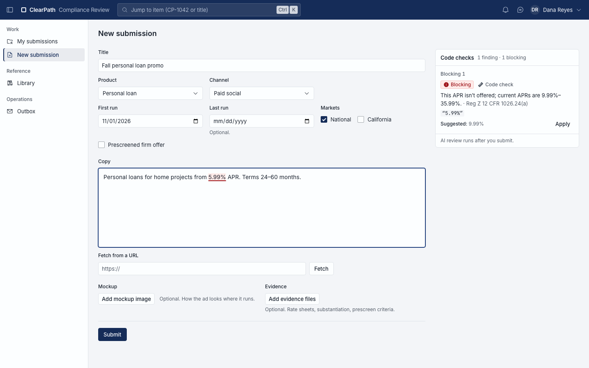

**My submissions** answers "any update?" without an email. It groups everything you own into *Waiting on you*
(changes requested, expired, or pulled), *With compliance* (who has it and what state it is in) and *Approved*
(with the expiry date). Each row that needs you has its own button: **Resubmit** or **Start new round**.

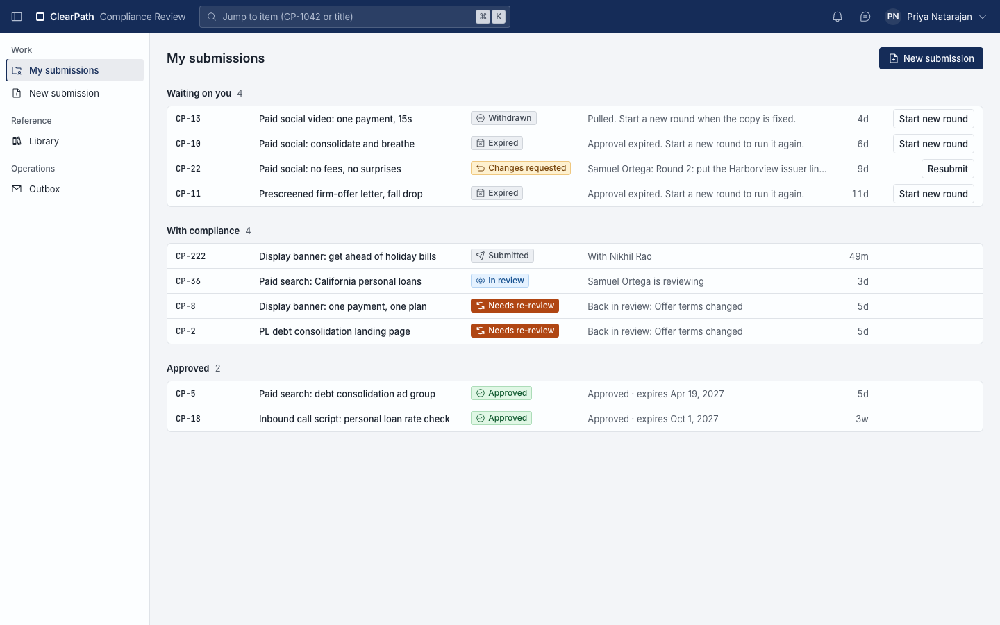

**Resubmit** puts the reviewer's requested changes and accepted findings at the top, so you fix exactly what was
asked. The code checks run again on your edits, and the *Changes vs* tab shows what you changed since the last
version. Resubmitting starts the next round.

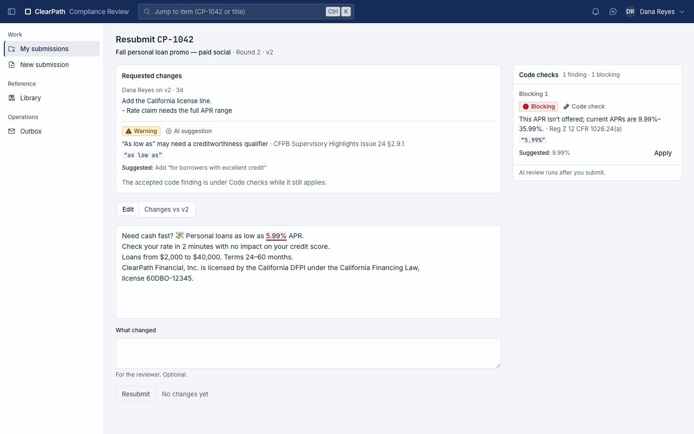

## Reviewing (reviewer and lead)

The **Queue** is a dense table of everything compliance has in hand, ordered by what to do first. Saved views
across the top (My queue, Unassigned, Waiting >3 days, Needs re-review, All active) and a count strip on the
right show where the backlog is. Every column can be filtered; assignee and risk can be edited in the row,
**Claim** takes an unassigned item, and **Board** switches to a column-per-status view. Clicking a row opens a
preview; opening it goes to the review screen. Leads also get a workload view per reviewer, which is what
automatic assignment balances against; reviewers who are out of office get no new work.

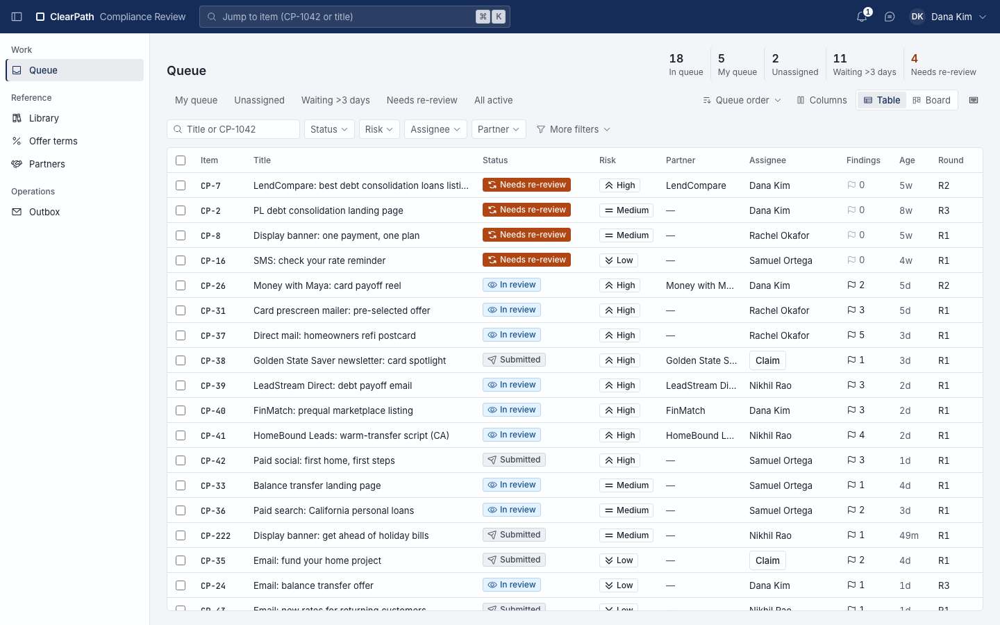

The **review screen** puts the copy in the center with flagged phrases underlined, and the findings on the
right. Each finding says which check raised it (code check, AI suggestion or checklist), cites the rule, quotes
the exact words and suggests a fix. You **Accept** it (it becomes a required change) or **Dismiss** it with a
reason. The decision bar at the top offers **Approve**, **Approve with edits**, **Request changes** and
**Reject**; a version cannot be approved while any finding is still open. The approve form asks what you checked
and which evidence you relied on.

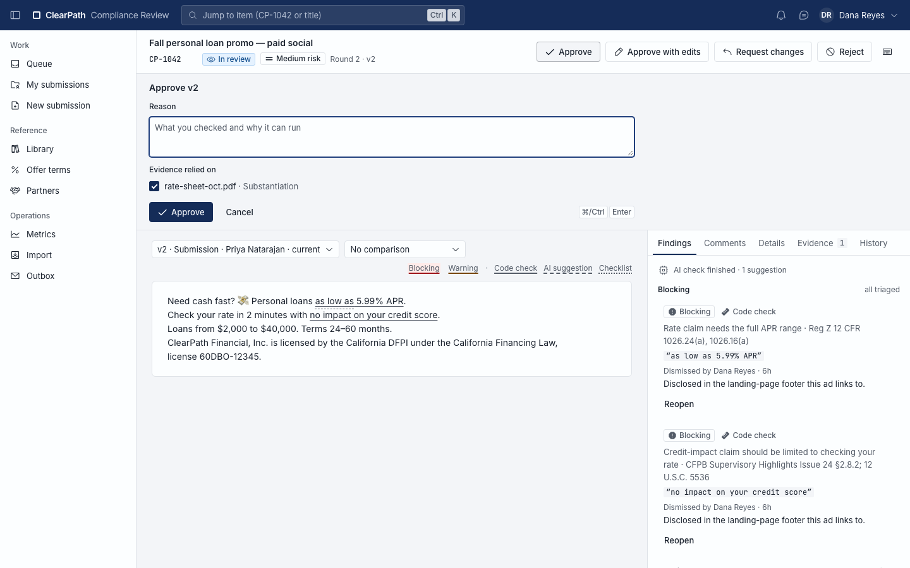

Every decision writes a **decision record** on the Details tab: outcome, who decided and when, the reason, the
offer-terms version the copy quoted, the rule-set date, whether the AI review was overridden and why, the expiry
date, and a fingerprint of each evidence file. This is what an examiner would ask for. The History tab shows
every action on the item in order.

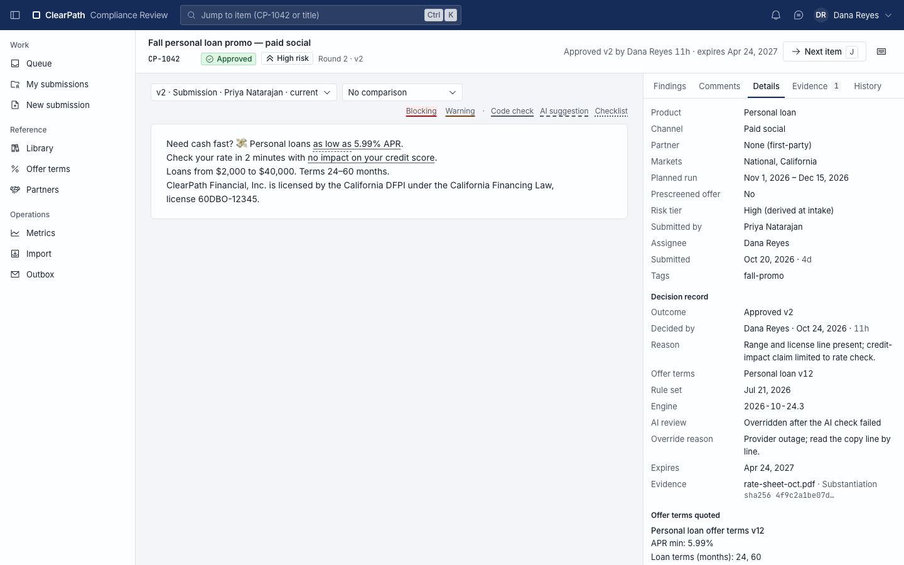

Reviewers can work without the mouse. **N** and **P** move between findings, **A** accepts, **D** dismisses,
**Shift+A** opens the approve form, **J** goes to the next item in your queue, and **?** shows the full list.
Shortcuts switch off while you are typing in a field.

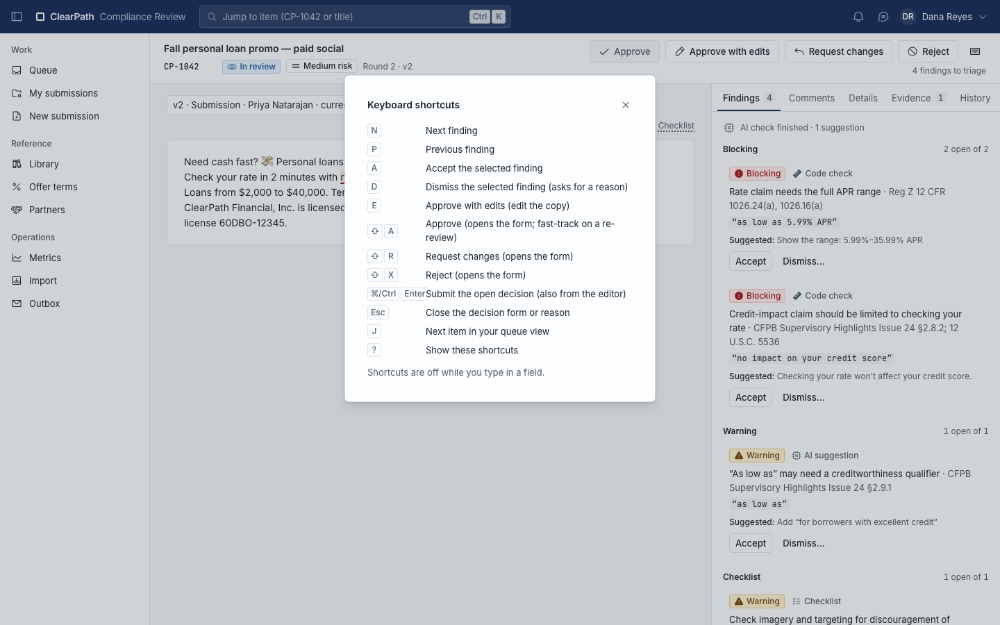

## When rates change (offer terms and fast-track)

**Offer terms** holds the current rates and fees for each product (personal loan, credit card, mortgage
prequalification), and only a lead can edit them. Before publishing a new version, an impact preview shows how
many approved items quote the old numbers, which ones are live and will need re-review, and which ones are not
live and will simply expire. Publishing writes the new numbers into a fresh version of each affected item and
sends the live ones back to the queue as re-reviews.

Those re-reviews land in a fast-track lane. The reviewer sees why the item came back, can compare the new
version with the approved one, and, when only the numbers changed, clears it with **Fast-track approve** in one
step. A lead can fast-track several at once from the queue.

## When a partner page changes (drift and re-review)

Approved copy that runs on a partner's site is a **placement**, and ClearPath checks each placement daily. The
check looks for the approved words on the live page and reports *unchanged*, *changed* (with a diff) or
*missing*; it also runs the code checks on the whole page. A changed or missing result sends the item back to the
queue as a re-review.

On the re-review, *Live page vs approved* shows exactly what the partner changed. The decision bar offers
**Check now** (once the partner restores the page) and **Pull** (take it down). **Reaffirm** appears only after
a check comes back unchanged. The Details tab lists every place the item runs and the last check for each.

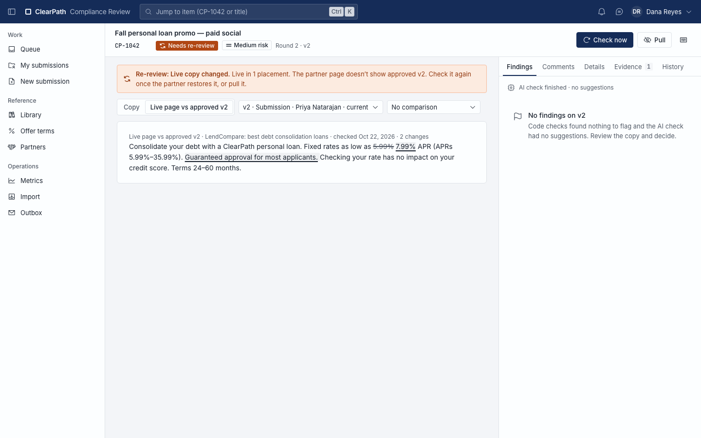

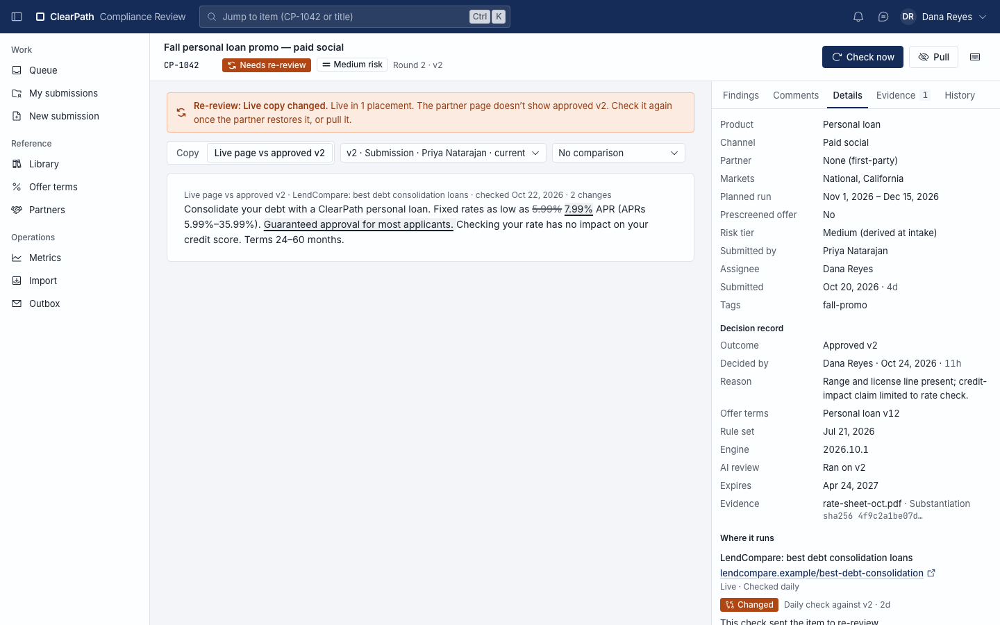

## Library, precedent search and export

The **Library** has two tabs. *Approved to run* lists everything currently approved, including the legacy items
imported from the old tracker, with filters for product, channel, partner, dates and whether a placement is
running. *Precedents* searches past approved copy for a phrase, such as "no impact on your credit score", so a
reviewer can see how the team handled the same wording before instead of starting from scratch.

**Export** builds a spreadsheet index of the filtered list for an audit or exam request. **Build pack** on any
item produces its evidence pack: the approved version, the decision record, the offer terms it quoted and the
evidence fingerprints.

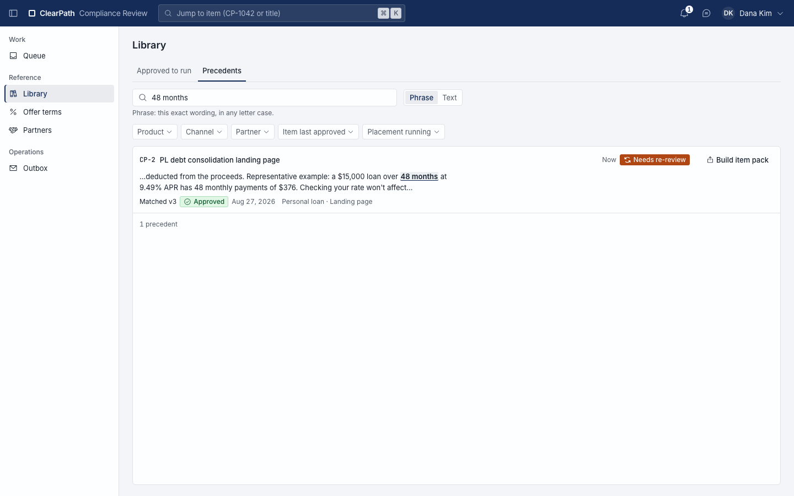

## Metrics

**Metrics** shows the numbers a lead manages to: time to first review, time per round, rounds per item, time to
fix live content, and throughput, plus how many items have waited more than 3, 7, 14 and 30 days. You can pick a
period and filter by product, channel or partner. History imported from the old tracker is shown separately from
what the app recorded itself, and can be included or left out.

## Notifications and quick-jump

The bell in the top bar lists what needs you: items assigned to you, items back for your review, approvals about
to expire and re-reviews. Clicking a notification opens the item. The search box at the top jumps straight to
any item by its key (such as CP-7) or title.

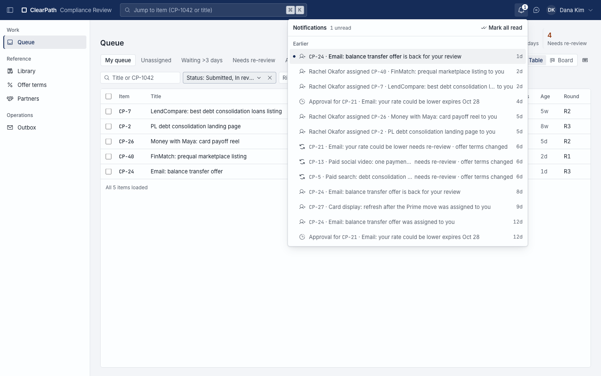

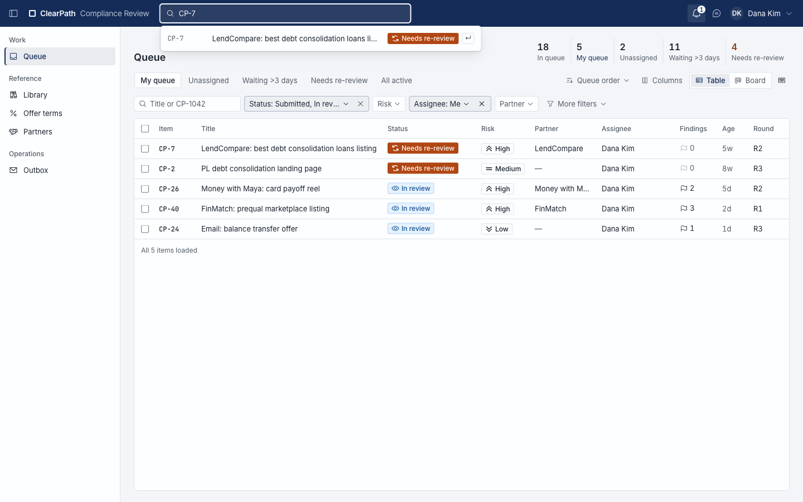

## The assistant and the Outbox

The assistant is a side panel available on every screen. You can ask it about items, findings and the queue, and
ask it to draft an email, for example a findings summary to the marketer. It never sends on its own: a draft
appears in the panel with **Send email**, **Edit** and **Don't send**, and nothing leaves until a person
approves it. The assistant also cannot approve, reject or change the status of an item; only a human decision
does that.

Approved emails land in the **Outbox**, which in the demo stands in for real mail. When the server has no AI
model configured, the panel says so and saved threads can still be read.

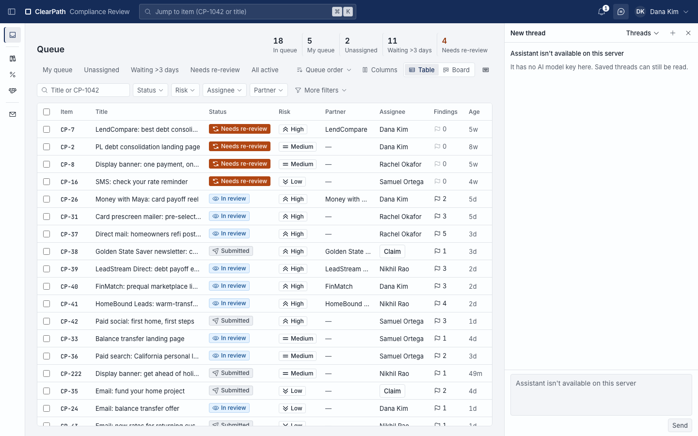

## Admin

**Import** brings in the old Excel tracker in steps: map the columns, map the status values, preview what will
happen to each row (warnings for duplicates, missing dates and unknown partners), then commit. Imported rows
become legacy items that keep their original request ID and history, and they appear in the Library and in
Metrics. Past imports stay viewable, read-only, so anyone can check how a messy row was read.

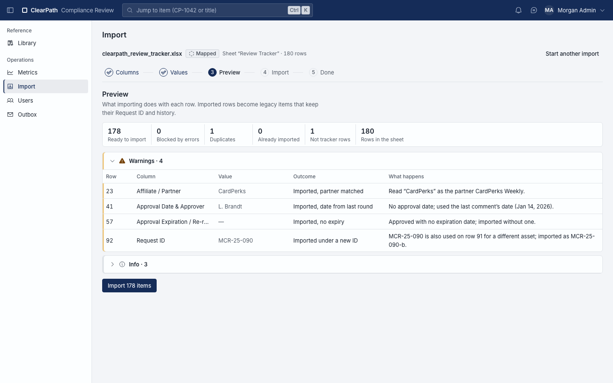

**Users** lists everyone with their roles, availability and account status. An admin can toggle roles, add a
person, mark a reviewer back in office, or deactivate an account; a deactivated reviewer's open items go to
whoever has the lightest load. There is always at least one admin. **Reset demo** in the account menu restores
the seeded demo data as a background job; people stay signed in, and a notice appears when it is done.

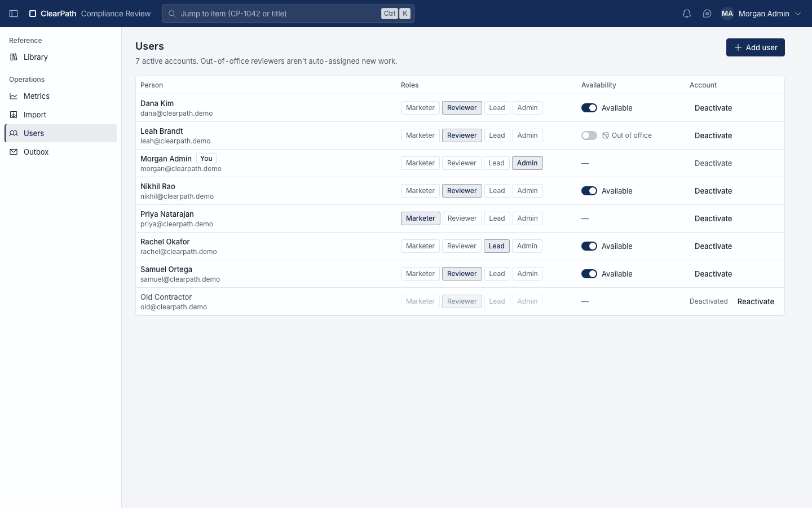

## Glossary

| Term | Meaning |
|---|---|
| Item | One piece of marketing under review, shown as `CP-1042`. |
| Version | One saved copy of the item's content: v1, v2. Versions never change once saved. |
| Round | One submit-and-review cycle. Resubmitting after changes are requested starts the next round. |
| Finding | A flagged problem, raised by a code check, the AI pre-review, a checklist or a reviewer. Each is accepted or dismissed with a reason. |
| Decision | Approve, Approve with edits, Request changes, or Reject. Each one writes a decision record. |
| Placement | Where approved content runs, such as a partner's web page. |
| Offer terms | The current rates and fees for each product, kept as numbered versions. |
| Partner | An affiliate, lead-gen site, marketplace or influencer that publishes content for the lender. |
| Re-review | Approved content sent back for review because offer terms changed, the approval is expiring, or the live page changed. |
| Fast-track | One-step re-approval when only the offer-terms numbers in the copy changed. |
| Drift | A difference between the live partner page and the approved copy, found by the daily check. |
| Evidence pack | The approved version, decision record, quoted offer terms and evidence fingerprints for an item, bundled for an exam. |
| Legacy item | A row imported from the old Excel tracker, kept with its original request ID and history. |
